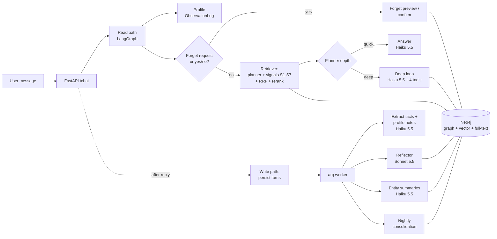

# auramem — long-term memory for LLMs

A self-hosted memory layer that lets any LLM remember a user across conversations, track how facts
change over time, and answer time-based questions correctly.

LLMs are stateless. Putting the whole chat history into every prompt is expensive and gets worse as
the history grows, and plain vector search over chat logs misses three things: questions about
time, values that changed, and facts spread across several conversations. auramem handles these
by doing four things:

- it **keeps every raw message**, searchable, forever (unless the user asks to forget it);
- in the background, it **extracts time-anchored facts** on top of those messages and tracks which
  value is current;
- it maintains a **compact, always-on profile** of the user that is prompt-cached;
- it **answers with multi-signal retrieval**, with an optional agentic search loop for hard
  questions.

| Headline result | |
| --- | --- |
| Accuracy, personal dataset, held-out test split, 3 runs | **96.1%** (target 85%, stretch 90%) |
| Accuracy, synthetic benchmark (500 conversations, 200 questions) | **91.0%** |
| Knowledge updates and conflicts | **100%** |
| Abstention ("you never told me that") | **100%**, 0 fabricated answers |
| Input tokens per answer, quick mode | ~4,400 (down 54% from ~8,900) |
| Prompt-cache reuse in a multi-turn chat | 90% of calls |

Further reading:

- [docs/plan.md](docs/plan.md): the full design spec.
- [docs/IMPLEMENTATION_REPORT.md](docs/IMPLEMENTATION_REPORT.md): what was built in each phase, how
  it was measured, and what changed.
- [evals/RESULTS.md](evals/RESULTS.md): every eval run, with its configuration.

---

## Contents

1. [Quick start](#quick-start)
2. [Using it as a library](#using-it-as-a-library)
3. [Terminal chatbot](#terminal-chatbot)
4. [HTTP API](#http-api)
5. [How it works](#how-it-works)
6. [Data model](#data-model)
7. [Configuration](#configuration)
8. [Evaluation](#evaluation)
9. [Development](#development)
10. [Operations](#operations)
11. [Known gaps](#known-gaps)
12. [Repository layout](#repository-layout)

---

## Quick start

### Requirements

| Requirement | Notes |
| --- | --- |
| Python 3.12 and [uv](https://docs.astral.sh/uv/) | `requires-python = ">=3.12,<3.13"` |
| Docker | Runs Neo4j and Redis |
| [Ollama](https://ollama.com) | Serves the embedding model. Install it natively, or run it in Docker with `--profile ollama` |
| An Anthropic API key | For the Claude Haiku 5.5 and Sonnet 5.5 calls |
| A GPU (optional) | The reranker uses CUDA when available and falls back to the CPU. On Windows, uv installs CUDA 12.8 PyTorch wheels; on Linux, CPU wheels |

### Setup

```bash
# 1. Install dependencies
uv sync

# 2. Configure: copy the example and set ANTHROPIC_API_KEY
cp .env.example .env

# 3. Start Neo4j and Redis
docker compose up -d
#    ...or, without a native Ollama install, also run Ollama in Docker:
docker compose --profile ollama up -d

# 4. Pull the embedding model
ollama pull embeddinggemma:300m

# 5. Apply the database migrations (the library also does this on first use)
uv run python -m memory.store.migrate
```

The reranker (`BAAI/bge-reranker-v2-m3`) downloads from Hugging Face the first time it runs.

### Try it

```bash
uv run python examples/chatbot.py              # chat in the terminal with memory
uv run python examples/chatbot.py --debug      # also show retrieval details after each answer
```

Or run the full service:

```bash
uv run arq memory.jobs.worker.WorkerSettings   # write path, background jobs, nightly consolidation
uv run uvicorn memory.api.main:app --reload    # HTTP API on http://localhost:8000
```

---

## Using it as a library

`auramem` is the public package; `memory` is the engine it wraps. To add it to another project,
run `uv add <path-to-this-repo>`, or build a wheel with `uv build` and `pip install` it.

```python
from auramem import AuraMem   # blocking; AsyncAuraMem has the same methods for async code

with AuraMem() as mem:        # settings from .env / environment, or AuraMem(neo4j_uri=...)
    # Answer with memory, and remember the exchange
    mem.chat("user-42", "I just moved to Leeds.")
    print(mem.chat("user-42", "Where do I live now?").text)

    # Bring your own LLM: get memory only, answer elsewhere, then store the exchange
    recall = mem.recall("user-42", "Plan my weekend")
    answer = my_llm(recall.as_prompt() + "\n\nPlan my weekend")
    mem.remember("user-42", "Plan my weekend", answer)

    # Forget: always previews first, deletes only after confirmation
    preview = mem.forget("user-42", "my old address")
    print(preview.render())
    if preview.preview_id:
        mem.confirm_forget("user-42", preview.preview_id)   # only after the user agrees

    data = mem.export("user-42")   # everything stored about the user, as JSON
```

Async code uses the same methods:

```python
from auramem import AsyncAuraMem

async with AsyncAuraMem() as mem:
    reply = await mem.chat("user-42", "What did I say about my trip?", mode="deep")
```

### Methods

| Method | What it does |
| --- | --- |
| `chat(user_id, message, *, session_id=None, mode="auto")` | Answers with memory and remembers the exchange. `mode` is `"auto"`, `"quick"` or `"deep"`. A "forget that I…" message gets a preview and a yes/no question back |
| `greet(user_id, *, session_id=None)` | An opening line that continues the user's last conversation |
| `recall(user_id, message, *, mode="quick")` | The memory block for a message, without answering it. `mode="deep"` returns the uncapped context |
| `remember(user_id, user_message, assistant_message, ...)` | Stores an exchange that was answered somewhere else |
| `profile(user_id)` | The always-on profile (ObservationLog) |
| `facts(user_id, *, history=False)` | Current facts. With `history=True`, also replaced and hypothetical ones |
| `stats(user_id)` | Counts of what is stored |
| `flush(user_id=None)` | Extracts facts now, instead of waiting for the threshold |
| `forget(user_id, what)` → `confirm_forget` / `cancel_forget` | Two-step deletion |
| `export(user_id)` | Everything stored about the user, as JSON (embeddings left out) |
| `delete_user(user_id)` | Deletes everything stored about the user |

**Extraction modes.** Pass `extraction=` to choose where fact extraction runs:

| Mode | Behaviour |
| --- | --- |
| `"inline"` (default) | Extracts in the same process once a user's unextracted text passes the threshold. Call `flush()` to extract everything now |
| `"worker"` | Hands extraction to the arq worker, which also runs the idle trigger and nightly consolidation |
| `"off"` | Only stores messages |

Schema migrations are applied automatically on first use. Neo4j and Ollama must be running, and
`ANTHROPIC_API_KEY` must be set.

---

## Terminal chatbot

[examples/chatbot.py](examples/chatbot.py) is a terminal chatbot that imports only `auramem`.

```bash
uv run python examples/chatbot.py                       # default user
uv run python examples/chatbot.py --user alice
uv run python examples/chatbot.py --mode deep --debug
```

**The assistant speaks first.** It picks up from the user's profile and the last turns of their
previous conversation, for example: *"Hi Sam, good to hear from you again. Last time we were
getting ready for your robotics startup interview on Friday…"*. A user with no memory yet gets a
fixed welcome, with no LLM call.

Talk normally; memory is used and updated automatically. Facts are extracted at `/quit`, on
`/flush`, or as a conversation grows.

| Command | What it does |
| --- | --- |
| `/memory [all \| words]` | Current facts. `all` adds replaced and hypothetical ones; `words` filters |
| `/profile` | The always-on profile |
| `/recall <q>` | The memory block for a question, without answering it |
| `/forget <what>` | Shows the matches, then deletes them after you confirm with `y` |
| `/wipe` | Deletes everything stored about the user; you type the user id to confirm |
| `/flush` | Extracts facts now |
| `/stats` | Counts of what is stored |
| `/mode auto\|quick\|deep`, `/deep <q>` | Choose the answering mode, or force deep search for one question |
| `/debug [on\|off\|context]` | Mode, plan, timings, tokens, the deep-search trace, and optionally the memory block |
| `/new` | Starts a new conversation |
| `/user <id>` | Switches user |
| `/export [file]` | Saves everything stored about the user as JSON |
| `/help`, `/quit` | The command list; exit |

Saying "forget that I…" in plain language works too: the bot shows what it found and asks first.

---

## HTTP API

Start with `uv run uvicorn memory.api.main:app --reload`. Interactive docs are at `/docs`.

| Method | Path | Body / query | Returns |
| --- | --- | --- | --- |
| `POST` | `/chat` | `{user_id, session_id, message, mode?}` | `{reply, model, prompt_version, memory_tokens, mode}` |
| `POST` | `/forget` | `{user_id, query}` | A preview of what would be deleted. **Nothing is deleted here** |
| `POST` | `/forget/confirm` | `{user_id, preview_id}` | A report of what was deleted |
| `POST` | `/forget/cancel` | `{user_id, preview_id}` | `{cancelled: bool}` |
| `GET` | `/export` | `?user_id=` | Everything stored about the user, as JSON |
| `GET` | `/health` | | Service health |

```bash
curl -s localhost:8000/chat -H 'content-type: application/json' \
  -d '{"user_id": "user-42", "session_id": "s1", "message": "Where do I work now?"}'
```

The reply is sent first; the exchange is persisted afterwards as a background task, and extraction
runs in the arq worker. The user never waits on extraction.

---

## How it works



The system has three parts: a synchronous **read path**, a single **Neo4j store**, and an
asynchronous **write path**. Neo4j holds the graph, the vector indexes and the full-text indexes,
so every fact links straight back to the exact messages it came from, and there is nothing to keep
in sync between stores.

### Stack

| Component | Technology | Role |
| --- | --- | --- |
| Store | Neo4j 2026.10 Community | Turns, facts, entities, profile; vector, full-text and range indexes |
| Queue | Redis 7 + arq | Background extraction, Reflector, summaries, nightly consolidation |
| Embeddings | `embeddinggemma:300m` via Ollama | 768-dim vectors; query/document prompts prepended manually |
| Reranker | `BAAI/bge-reranker-v2-m3` (sentence-transformers, fp16 on GPU) | Cross-encoder scoring against the original question |
| Answering, quick and deep | `claude-haiku-5-5` (medium effort) | Answers |
| Extractor, planner fallback, entity summaries | `claude-haiku-5-5` | Background and planning work |
| Reflector, entity tiebreaks, forget rewrite | `claude-sonnet-5-5` | Higher-judgment rewrites |
| Orchestration | LangGraph, LangChain Anthropic | Read graph; structured LLM calls |
| API | FastAPI | `/chat`, `/forget`, `/export`, `/health` |
| Time parsing | `dateparser` + a rules layer | LLM fallback only for what the rules miss |

### Design principles

1. **Raw turns are the foundation.** Every user and assistant message is stored verbatim and
   searchable. Extraction adds structure on top; it never replaces source text.
2. **Structure time, not everything.** Extract time-anchored facts and events; skip exhaustive
   knowledge-graph triples.
3. **ADD-only.** A fact is never overwritten or deleted because it changed. Both versions are kept
   with their dates; the older one is marked `is_latest = false` and linked by `SUPERSEDES`.
4. **Attribute everything.** Facts the assistant stated are stored too, tagged with who said them.
5. **Multi-signal retrieval.** Vector + BM25 + entity + time + graph, fused with RRF and reranked by
   a cross-encoder. Exact-match search is mandatory.
6. **The planner never gates retrieval.** It runs in parallel and adds guidance; a wrong "no memory
   needed" decision can't silently drop context.
7. **Heavy work is asynchronous.** The user never waits on extraction, entity resolution or
   reflection.
8. **Measure honestly.** A fixed, versioned judge, a dev/test split, and ablations.

### Write path (remembering)

1. **Persist** (synchronous, no LLM). Both turns of an exchange are stored and embedded right away,
   tagged with their source (typed, pasted or tool output). Raw text is searchable immediately.
2. **Trigger.** Extraction runs when unextracted text reaches about 2,200 tokens, or after 10
   minutes of silence. One job per user at a time, behind a Redis lock, so writes for one user never
   race.
3. **Extract** (Haiku, prompt `extract_v5`). Batches of up to 25 turns with a 5-turn overlap. The
   output contains:
   - narrative facts, each with type, attribution, entities, absolute dates resolved against each
     turn's own timestamp, a slot key (`attribute_key`, e.g. `works_at`), aliases, confidence and a
     hypothetical flag;
   - a judgment of how each fact relates to stored facts: new, restatement, update or
     contradiction. A value counts as an *update* only when the user signals a change; otherwise
     it's a *contradiction*;
   - 0–3 dated, prioritized notes for the profile.
4. **Filter and normalize.** Drop facts with confidence under 0.6, normalize slot names through a
   synonym map, attribute pasted or tool content to a third party (so pasted text can't create
   user facts), and embed each fact *with* a readable date: "… (in March 2026)".
5. **Resolve entities.** An exact name or alias match wins. Otherwise
   `score = 0.5 × string similarity + 0.3 × embedding similarity + 0.2 × co-occurrence`:
   ≥ 0.85 merges, 0.65–0.85 goes to a Sonnet tiebreak, below 0.65 creates a new entity.
6. **Commit in one transaction:** facts (with a duplicate guard), supersession (the newer value in
   the same subject and slot wins; events never supersede states, so one chicken dinner doesn't end
   "is vegetarian"), conflict links, profile notes, and the extraction watermark.
7. **Follow-ups.** The Reflector condenses the profile when it passes 2,000 tokens; summaries of
   touched entities refresh, debounced.

### Read path, quick mode

1. **Load the session and the profile.** The profile goes right after the fixed instructions,
   under a prompt-cache breakpoint.
2. **Forget check.** A "forget that I…" message, or a yes/no reply to a forget preview, is handled
   here.
3. **Plan and retrieve in parallel.** Retrieval never waits for the planner.
   - The **planner** is rules-first: `dateparser` and a rules layer resolve time expressions, regex
     rules choose the depth (`none`, `quick` or `deep`), and names become entities. A Haiku
     fallback (`plan_v2`) handles only times relative to personal events ("after my trip").
   - **Baseline signals** run on the raw message, plus the previous assistant turn to resolve
     pronouns.
4. **Signals** (up to 50 hits each, all filtered by user inside the index):

   | Signal | Source |
   | --- | --- |
   | S1 / S2 | Vector search over facts / turns |
   | S3 / S4 | BM25 full-text over facts (text + aliases) / turns |
   | S5 | Facts mentioning entities named in the question |
   | S6 / S6t | Facts overlapping the planned time range / turns from that range |
   | S7 | One hop from the top 10 facts via shared entities and `SUPERSEDES` |
   | Rewrites | S1–S4 rerun for each planner rewrite |

5. **Fuse** with reciprocal rank fusion (k = 60), expand with S7, fuse again.
6. **Rerank** the top 100 with bge-reranker-v2-m3 against the **original** question, never a
   rewrite. Selection is rank-based: absolute score cut-offs dropped evidence badly in testing.
7. **Assemble** within a 4,000-token safety cap:
   - **Facts:** the top 10, plus up to 5 linked facts (the other side of a supersession or
     conflict), so "before/now" pairs arrive together. Each is labelled `[latest]`,
     `[superseded on 2026-08-10]` or `[conflicting]`, with its date and, when different, the date
     it was told.
   - **Excerpts:** up to 10 conversation turns (matches plus one neighbour), grouped by conversation
     under date headers. Turns already covered by a selected fact are skipped; assistant turns
     added only as context are cut to 200 characters.
8. **Answer** (Haiku, `answer_v7`). The rules: follow the profile's preferences; prefer `[latest]`
   but say it may have changed; give both values for `[conflicting]`; treat the assistant's past
   statements as "said", not as fact; present past health and finance details as history; abstain
   rather than guess.

### Deep mode

For questions that need counting, ordering, date arithmetic, an earlier value, several items at
once, or an overview, the planner routes to **deep mode** ([src/memory/deep.py](src/memory/deep.py)).
Callers can also force it with `mode="deep"`.

- It starts from every reranked candidate, with no fact, turn or token caps.
- At each step Haiku returns a typed `DeepStep`: an answer, or one or more tool calls.

  | Tool | What it does |
  | --- | --- |
  | `search_facts(query, start?, end?, entity?)` | Vector + BM25 over facts, optionally by time range and entity |
  | `search_turns(query, start?, end?)` | Vector + BM25 over raw turns |
  | `grep(text)` | Exact text in every turn and fact |
  | `timeline(name, start?, end?)` | Every fact about one entity, in date order |

- Every tool result is reranked against the original question; only new items are added.
- **Stopping:** the model answers, or 2 searches in a row find nothing new scoring at least 0.01
  (repeated searches count as finding nothing). A 10-minute timeout and the context window are
  backstops for outages only.

In practice the uncapped first context (about 13,000–14,500 tokens) usually holds the answer: only
3 of 102 deep questions on the synthetic set ran a tool.

### The always-on profile (ObservationLog)

- Each extraction appends 0–3 dated, prioritized notes, such as
  `- [2026-01-05] (high) Prefers concise bullet answers…`.
- The profile is injected into every answer as a cached system-prompt prefix. In a 21-message
  simulation, 90% of calls read it from cache.
- **Reflector** (Sonnet, `reflect_v1`): above 2,000 tokens it rewrites the profile toward 1,000,
  merging related notes and dropping outdated, low-priority detail. A safety check rejects any
  rewrite that loses more than 20% of the names and numbers in high-priority notes, and every
  rewrite snapshots the previous version for rollback.
- **Entity summaries** (Haiku): a neutral 2–4 sentence profile for each entity with at least 3
  facts.

---

## Data model

Everything lives in one Neo4j database. Every node carries `user_id`, and every query filters on it.

| Node | Holds |
| --- | --- |
| `User` | The account |
| `Session` | One conversation, with its extraction watermark |
| `Turn` | A raw message: text, role, time, sequence number, source, embedding |
| `Fact` | One self-contained sentence: type, who said it, subject, slot key, time range and precision, aliases, confidence, `is_latest`, `is_hypothetical`, embedding of the text with its date |
| `Entity` | A person, place, organization or other thing: name, aliases, summary, embedding |
| `ObservationLog` / `ObservationLogVersion` | The profile, and old copies for rollback |
| `PendingForget` / `DeletionEvent` | A forget preview awaiting confirmation; the content-free audit trail |

Fact types: `event`, `state`, `plan`, `preference`, `relationship`, `opinion`, `trait`.

| Edge | Meaning |
| --- | --- |
| `HAS_SESSION`, `IN_SESSION`, `NEXT` | Ownership and message order |
| `DERIVED_FROM` | The turns a fact came from |
| `MENTIONS` | The entities a fact mentions |
| `SUPERSEDES` | A newer value replaces an older one; the old fact stays |
| `CONFLICTS_WITH` | Two contradictory values, neither replaced |

**Indexes.** Nine versioned, checksummed Cypher migrations in
[src/memory/store/migrations/](src/memory/store/migrations/) create:

- vector indexes on turns, facts and entities, filtering **inside** the index on `user_id`,
  `is_latest` and `is_hypothetical` (turns also on time);
- full-text (BM25) indexes, with a hashed user key in the query that keeps every search inside one
  user;
- range indexes and constraints.

---

## Configuration

Settings are read from the environment or `.env` by [src/memory/config.py](src/memory/config.py),
which holds every threshold in the system. Field names map to upper-case environment variables.

**Connection settings** (see [.env.example](.env.example)):

| Variable | Default |
| --- | --- |
| `ANTHROPIC_API_KEY` | — (required) |
| `NEO4J_URI` / `NEO4J_USER` / `NEO4J_PASSWORD` / `NEO4J_DATABASE` | `bolt://localhost:7687` / `neo4j` / `memory-dev-password` / `neo4j` |
| `REDIS_URL` | `redis://localhost:6379/0` |
| `OLLAMA_URL` | `http://localhost:11434` |

**Commonly tuned settings:**

| Variable | Default | Meaning |
| --- | --- | --- |
| `ANSWER_MODEL` / `DEEP_ANSWER_MODEL` | `claude-haiku-5-5` | Answering models |
| `REFLECTOR_MODEL` | `claude-sonnet-5-5` | Profile condensing |
| `DEFAULT_TIMEZONE` | `UTC` | Used to resolve relative dates |
| `EXTRACT_TOKEN_THRESHOLD` | `2200` | Unextracted tokens that trigger extraction |
| `EXTRACT_IDLE_SECONDS` | `600` | Idle time that triggers extraction |
| `MIN_FACT_CONFIDENCE` | `0.6` | Facts below this are dropped |
| `ENTITY_MERGE` / `ENTITY_LLM_BAND_LOW` | `0.85` / `0.65` | Entity resolution bands |
| `SIGNAL_TOP_K` / `RRF_K` / `RERANK_CANDIDATES` | `50` / `60` / `100` | Retrieval breadth |
| `MAX_FACTS` / `MAX_EXCERPT_TURNS` | `10` / `10` | Quick-mode context limits |
| `MEMORY_TOKEN_BUDGET` | `4000` | Quick-mode safety cap |
| `RERANKER_DEVICE` | `auto` | `cuda` when available, otherwise `cpu` |
| `DEEP_PATIENCE` / `DEEP_MIN_RELEVANCE` | `2` / `0.01` | Deep-mode stopping rule |
| `OBSLOG_REFLECT_AT` / `OBSLOG_TARGET` | `2000` / `1000` | Profile condensing thresholds |
| `FORGET_MIN_RELEVANCE` | `0.5` | Minimum match score for a forget preview |
| `CONSOLIDATION_HOUR` | `3` | Hour of the nightly consolidation job (worker's local time) |
| `LLM_PRICES` | empty | USD per million tokens, per model; enables cost in traces |
| `TRACE_FILE` / `LOG_FORMAT` | empty / `text` | Also write LLM-call traces to a JSONL file; `json` makes every log line JSON |

Prompts are versioned files in [src/memory/prompts/](src/memory/prompts/). A used version is never
edited; a new version is added and selected with the matching `*_PROMPT_VERSION` setting
(`ANSWER_PROMPT_VERSION=v7`, `EXTRACTOR_PROMPT_VERSION=v5`, …). The version is stored on every
output.

---

## Evaluation

Development is evaluated on two datasets, with a fixed, versioned LLM judge.

| Dataset | Content | Questions |
| --- | --- | --- |
| Personal dataset | 170 real facts rendered into dated conversations, in three tiers: small, medium (+34k tokens of distractor conversations) and large (+114k tokens; 203 conversations, 1,474 turns) | 108 across 10 types; 65 dev / 43 test |
| Synthetic benchmark ([evals/synth](evals/synth)) | A fictional persona over 24 months: 500 conversations (350 persona, 150 distractor), 2,452 turns, fixed seed | 200 across 9 types; 59 dev / 141 test |

Question types include `single_fact`, `multi_fact`, `conflict`, `knowledge_update`, `temporal`,
`inference`, `abstention`, `sensitive_history`, `preference_application` and `assistant_recall`.

| Level | What it runs | LLM cost |
| --- | --- | --- |
| L0 | Evidence recall: is every evidence turn, or a fact derived from it, in the context? | None |
| L1 | One answer per question, graded by the judge | Low |
| L2 | Three runs per question, averaged; phase gates on the large tier's test split | Medium |

**Judge:** `judge_v1` ([evals/custom/judge_v1.md](evals/custom/judge_v1.md)), Claude Sonnet 5.5,
returning `CORRECT` or `WRONG` with a reason. It is never edited without a version bump. Each wrong
answer is classified as a `retrieval_miss`, `extraction_miss`, `reasoning_error` or `fabrication`.

**Hygiene:** tuning uses dev questions only; active prompts are scanned for leaked corpus terms;
ingestion is fingerprinted so later runs reuse stored data; every run writes a per-question report
with the exact context the model saw. Single runs differ by about ±3 questions from noise alone,
which is why gates use 3-run averages.

```bash
uv run python -m evals.custom.run --level L1 --tier medium --split dev               # day-to-day dev check
uv run python -m evals.custom.run --level L2                                         # gate: large tier, test split, 3 runs
uv run python -m evals.custom.run --dataset synth --level L1                         # synthetic benchmark
uv run python -m evals.custom.run --level L1 --tier large --split all --no-profile   # an ablation
uv run python -m evals.custom.cache_sim --source-user <user>                         # multi-turn cache check
uv run python -m evals.load_test --user-id <user> --users 20                         # load test, no LLM cost
```

### How performance improved

Personal dataset, held-out test split, 3-run gates:

| Stage | Accuracy | temporal | knowledge_update | abstention | multi_fact | Evidence recall |
| --- | --- | --- | --- | --- | --- | --- |
| B0: turns only | 95.3% | 100% | 100% | 100% | 81.8% | 90% |
| P3: + planner, reranker | 91.5% | 50% | 66.7% | 100% | 81.8% | 85% |
| P4: + facts | 93.0% | **100%** | 50% | 77.8% | 87.9% | **95%** |
| P5: + supersession, entities | **96.9%** | 100% | **100%** | **100%** | 90.9% | 95% |
| P8: final (all features, reduced context, deep mode) | **96.1%** | 100% | 100% | 100% | 93.9% | 90% |

What each step bought:

1. **Facts with absolute dates:** date questions 50% → 100%; evidence recall 85% → 95%.
2. **Supersession labels:** knowledge updates 50% → 100%; "latest is not proof it's still true"
   wording took abstention to 100%.
3. **The profile:** implicit preferences 64% → 91% on the synthetic set.
4. **The conflict state:** contradictions stay visible instead of being silently replaced.
5. **Context reduction:** −54% input tokens and −82% full-price tokens at the same accuracy.
6. **Deep mode:** recovered the multi-fact question lost to the context cut; every deep-routed
   question was correct in the final gate.
7. **Reranker batching:** ~1.8× faster for one user, +59% throughput, identical scores.

The full phase-by-phase story is in
[docs/IMPLEMENTATION_REPORT.md](docs/IMPLEMENTATION_REPORT.md#11-stage-by-stage).

---

## Development

The project is built in phases (see [docs/plan.md](docs/plan.md) section 9); all nine (0–8) are
complete. Project rules for contributors are in [CLAUDE.md](CLAUDE.md). The most important:

- Raw turns are never modified or deleted except by an explicit forget request.
- Facts are ADD-only.
- Every store function takes `user_id`; every vector and full-text query filters by user inside the
  index.
- All Cypher lives in `src/memory/store/`.
- Every LLM call returns a Pydantic model from `src/memory/models/` through structured output.
- All thresholds live in `config.py`.
- Rerank against the original question, never a rewrite.
- Nothing in the read path waits on extraction.
- Tune on the dev split only; never add question-specific rules to answer prompts.

### Tests and checks

```bash
uv run pytest                              # unit + integration (integration needs Docker)
uv run pytest -m llm tests/extraction      # golden extraction tests: real Claude calls, costs money
uv run ruff check
uv run mypy src                            # strict mode
```

| Marker | Meaning |
| --- | --- |
| `integration` | Runs against real Neo4j and Redis via testcontainers. Retrieval tests never mock the database |
| `ollama` | Needs a running Ollama with the embedding model; skipped if unreachable |
| `llm` | Calls the Claude API; excluded by default, opt in with `-m llm` |

The suite has 371 tests, including cross-user isolation tests proving vector and BM25 search never
return another user's data. Pre-commit runs ruff, mypy and a guard that blocks personal data files
from being committed. CI ([.github/workflows/ci.yml](.github/workflows/ci.yml)) runs lint and type
checks.

After any change to retrieval, extraction or prompts, run L0 and L1 on the dev split and log the
per-category delta in [evals/RESULTS.md](evals/RESULTS.md) with the date, git SHA, configuration
and model versions.

---

## Operations

| Feature | How it works |
| --- | --- |
| **Forget** ([forget.py](src/memory/forget.py)) | Triggered by "forget that I…" in chat or `POST /forget`. It first **only shows** what matched, and deletes only after "yes" in chat or `POST /forget/confirm`. It then hard-deletes the matched facts and turns, their embeddings, the forget request itself, and orphaned entities; rewrites the profile without the item; purges every saved profile version; and rebuilds affected entity summaries. A `DeletionEvent` records counts only, never content. "No", or a preview older than 60 minutes, deletes nothing. Questions like "what did I forget to pack?" are not forget requests |
| **Export** | `GET /export?user_id=` returns sessions, turns, facts, entities, profile, versions and deletion events as JSON (no embeddings) |
| **Nightly consolidation** ([consolidate.py](src/memory/consolidate.py)) | An arq cron job at 03:00. Re-runs entity resolution across each user's graph to merge missed duplicates, repairs `is_latest` flags that disagree with `SUPERSEDES` edges, and reports slots with several "latest" facts and facts whose source turns are gone |
| **Re-embedding** ([jobs/reembed.py](src/memory/jobs/reembed.py)) | For an embedding model change: `uv run python -m memory.jobs.reembed --model <new model>`. Stages new vectors in `embedding_next` (resumable), then swaps per node type in one transaction each, so an index never mixes models. Refuses a model with a different vector size |
| **Tracing** ([obs.py](src/memory/obs.py)) | Every LLM call logs one JSON `llm_call` record: model, call type, prompt id, input/output/cache tokens, latency, success, and cost when `LLM_PRICES` is set. All LLM calls retry up to 4 times on 5xx, 429 and connection errors |
| **Load test** ([evals/load_test.py](evals/load_test.py)) | N simultaneous users on the real read path with a fake answering model: no LLM cost, nothing written |

---

## Known gaps

Results against the success criteria in [docs/plan.md](docs/plan.md) section 1:

| Criterion | Target | Result | |
| --- | --- | --- | --- |
| Answer accuracy (large tier, test split, 3 runs) | ≥ 85%, stretch 90% | **96.1%** | ✅ |
| `conflict` and `knowledge_update` | 100% | 100% | ✅ |
| `abstention` | ≥ 90%, ≤ 1 fabrication | 100%, 0 | ✅ |
| Evidence recall | ≥ 95% | 90% | ⚠️ |
| Read-path added latency, quick mode | p95 < 600 ms | 852 ms | ⚠️ |
| Memory context per query | 4,000–8,000 tokens | ~1,300–1,500 quick, ~13,000 deep | ⚠️ by decision |
| Judge agreement with hand labels | ≥ 90% | not measured | ⚠️ |
| Write-path lag | p95 < 30 s | not measured | ⚠️ |

| Issue | Cause | Possible next fix |
| --- | --- | --- |
| Evidence recall 90% | Context deliberately cut to 10 facts and 10 turns for cost; accuracy didn't drop | More facts only for multi-item questions, or wider deep routing |
| Quick-mode latency 852 ms | The cross-encoder on a 4 GB laptop GPU; everything else takes ~170 ms | A larger GPU; reranking fewer candidates |
| ~1.65 queries/s under 20 simultaneous users | GPU capacity; embeddings and Neo4j queue too | Server hardware; a GPU-backed embedding service |
| Profile condenses to ~2,000 tokens, not 1,000 | `reflect_v1` keeps every high-priority note in full | A stricter condensing prompt |
| Occasional false supersession across different things in the same slot (e.g. a job offer vs the job taken) | Same slot and subject | Scope slots by organization or status |
| Judge agreement unmeasured | Hand-grading waived | [evals/custom/handgrade.py](evals/custom/handgrade.py) is ready |
| Ablations inconclusive on the personal set | Small, easy corpus near the ceiling | Run the ablations on the synthetic set |

---

## Repository layout

| Path | Contents |
| --- | --- |
| `src/auramem/` | Public library API: `AuraMem`, `AsyncAuraMem`, `Recall` |
| `examples/chatbot.py` | Terminal chatbot built on `auramem` |
| `src/memory/client.py` | `MemoryClient`: respond, remember, forget preview/confirm/cancel, export |
| `src/memory/api/main.py` | FastAPI endpoints |
| `src/memory/graphs/` | Read graph (forget check → retrieve → quick or deep answer), persistence, traced structured LLM calls, cached system prefix |
| `src/memory/retrieve/` | Signals S1–S7, RRF fusion, selection and assembly |
| `src/memory/plan.py` | Rules-first query planner and routing |
| `src/memory/rerank.py` | Cross-encoder with length-sorted, combined batching |
| `src/memory/deep.py` | Deep-mode tools, loop and stopping rules |
| `src/memory/extract.py`, `entities.py` | Extraction, slot normalization, supersession, entity resolution |
| `src/memory/observe.py` | Profile notes, Reflector, entity summaries |
| `src/memory/forget.py`, `consolidate.py`, `obs.py` | Forget, nightly consolidation, tracing |
| `src/memory/jobs/` | arq queue and worker (including the nightly cron) and the re-embedding job |
| `src/memory/store/` | All Cypher (`neo4j.py`), the migration runner and the 9 migrations |
| `src/memory/models/` | Pydantic models for every LLM output and record |
| `src/memory/prompts/` | Versioned prompts: `answer_v1`–`v7`, `extract_v1`–`v5`, `plan_v1`–`v2`, `deep_v1`, `reflect_v1`, `forget_v1`, `greet_v1`, `entity_summary_v1`, `entity_tiebreak_v1` |
| `src/memory/config.py` | Every setting and threshold |
| `evals/custom/` | Eval runner, judge, ingestion, reports, cache simulation, hand-grading |
| `evals/synth/` | Synthetic benchmark generator and data |
| `evals/load_test.py` | Load test |
| `evals/RESULTS.md` | Every eval run and gate verdict |
| `tests/unit`, `tests/integration`, `tests/extraction` | Unit tests, tests on real Neo4j and Redis, golden LLM extraction tests |
| `docs/` | Design plan, implementation report, resume notes |

---

## Privacy note

Memory content is sent to the Anthropic API during extraction, answering and judging. Embeddings,
reranking and storage stay local. The personal eval dataset contains real personal details: keep
its data files and [evals/RESULTS.md](evals/RESULTS.md) out of any public repository (the
pre-commit guard blocks the data files, but not the results log).
