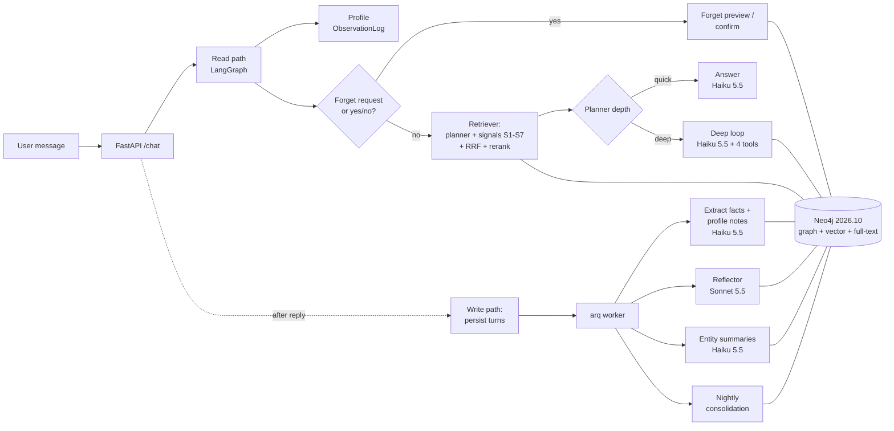

# Long-term memory layer: implementation report

This report covers the build of the self-hosted long-term memory layer specified in
[docs/plan.md](plan.md), phase by phase. For each stage it records what was built, how it was
measured, what the numbers were, and what changed as a result. The raw eval logs are in
[evals/RESULTS.md](../evals/RESULTS.md); this document summarizes them.

Contents:

1. [Summary](#1-summary)
2. [What the system does](#2-what-the-system-does)
3. [Architecture](#3-architecture)
4. [Data model](#4-data-model)
5. [Write path](#5-write-path-remembering)
6. [Read path, quick mode](#6-read-path-quick-mode)
7. [Deep mode](#7-deep-mode)
8. [The always-on profile](#8-the-always-on-profile-observationlog)
9. [Operations: forget, export, consolidation, re-embedding, tracing](#9-operations)
10. [How it was evaluated](#10-how-it-was-evaluated)
11. [Stage by stage](#11-stage-by-stage)
12. [How performance improved](#12-how-performance-improved)
13. [Final results against the success criteria](#13-final-results-against-the-success-criteria)
14. [Known issues and gaps](#14-known-issues-and-gaps)
15. [Decisions made along the way](#15-decisions-made-along-the-way)
16. [Running it](#16-running-it)
17. [Repository map](#17-repository-map)

---

## 1. Summary

The memory layer gives any LLM durable memory of one user across conversations:

- It keeps every raw message.
- In the background, it extracts time-anchored facts and maintains a compact profile of the user.
- It answers with multi-signal retrieval. An optional search loop handles hard questions.

All nine phases of the plan (0 to 8) are built, tested (362 automated tests) and evaluated.

| Headline | Result |
| --- | --- |
| Accuracy, personal dataset, held-out test split, 3 runs (final gate) | **96.1%** (target 85%, stretch 90%) |
| Accuracy, personal dataset, all 108 questions | **105/108** (97.2%) |
| Accuracy, synthetic benchmark (500 conversations, 200 questions) | **182/200** (91.0%) |
| Knowledge updates and conflicts (personal test split) | 100% |
| Abstention ("you never told me that") | 100%, 0 fabricated answers |
| Input tokens per answer, quick mode | ~4,400 (down from ~8,900, **-54%**) |
| Prompt-cache reuse in a multi-turn chat | 90% of calls |
| Read path without the reranker | ~170 ms |

The biggest single improvements:

- **Fact extraction** fixed time questions: 50% → 100%.
- **Supersession** (tracking which value is current) fixed knowledge updates: 50% → 100%.
- **The profile** fixed implicit preferences on the synthetic set: 64% → 91%.
- **Context reduction** halved the tokens per answer at the same accuracy.

The remaining gaps are documented in [section 14](#14-known-issues-and-gaps):

- evidence recall is 90% against a 95% target
- quick-mode search latency is 852 ms against a 600 ms target, because of the reranker on a 4 GB laptop GPU
- judge agreement and write-path lag were not measured

---

## 2. What the system does

**Problem.** LLMs are stateless. Putting the whole history into every prompt is expensive, and it
degrades as the history grows. Plain vector search over chat logs misses three things:

- time questions
- values that changed over time
- facts spread across several conversations

**Approach, from [plan.md](plan.md) section 1:**

1. **Never lose anything.** Raw messages are permanent unless the user explicitly asks to forget them.
2. **Correct knowledge updates.** "Where do I work now?" gives the latest value, and "where did I work before?" still works.
3. **Correct time reasoning.** Relative dates resolve to absolute ranges.
4. **Implicit personalization.** Preferences apply even when the user doesn't mention them.
5. **Abstain instead of inventing.**
6. **Little added latency on the read path.** All heavy work is asynchronous.
7. **Strict per-user isolation and real deletion.**

Project rules ([CLAUDE.md](../CLAUDE.md)) held throughout:

- Facts are ADD-only: a change sets `is_latest=false` and adds `SUPERSEDES`, never an overwrite.
- Every store function takes `user_id`, and every vector or full-text query filters by user inside the index.
- All Cypher lives in `src/memory/store/`.
- Every LLM call returns a Pydantic model through structured output.
- Prompts are versioned files; a used version is never edited, a new version is added instead.
- Every threshold lives in `config.py`.
- Reranking scores against the *original* question, never a rewrite.
- Tuning happens only on the dev split.

---

## 3. Architecture



| Component | Technology | Role |
| --- | --- | --- |
| Store | Neo4j 2026.10.1 Community | Turns, facts, entities, profile, all indexes (vector, full-text, range) |
| Queue | Redis + arq | Background extraction, Reflector, summaries, nightly consolidation |
| Embeddings | EmbeddingGemma 300m via Ollama | 768-dim vectors, with the model's query/document prompts prepended manually |
| Reranker | BAAI/bge-reranker-v2-m3 (sentence-transformers, GPU fp16) | Cross-encoder scoring against the original question |
| Answering model, quick and deep | claude-haiku-5-5 (medium effort) | Answers |
| Extractor, planner fallback, entity summaries | claude-haiku-5-5 | Background and planning work |
| Reflector, entity tiebreaks, forget rewrite | claude-sonnet-5-5 | Higher-judgment rewrites |
| Orchestration | LangGraph (read path), LangChain Anthropic | Graph of read steps and structured LLM calls |
| API | FastAPI | `/chat`, `/forget`, `/forget/confirm`, `/forget/cancel`, `/export`, `/health` |

---

## 4. Data model

**Nodes, all carrying `user_id`:**

| Node | Holds |
| --- | --- |
| `User` | The account, keyed by `user_id` |
| `Session` | One conversation, with its extraction watermark |
| `Turn` | A raw message: text, role, time, sequence number, source (typed / pasted / tool), embedding |
| `Fact` | One self-contained sentence: type (state, event, plan, preference, trait, relationship, opinion), who said it, subject, slot key (`attribute_key`), time range and precision, aliases, confidence, `is_latest`, `is_hypothetical`, embedding of the text with its date |
| `Entity` | A person, place, organization or other thing: name, aliases, summary, embedding |
| `ObservationLog` | The user's profile; `ObservationLogVersion` holds old copies for rollback |
| `PendingForget` / `DeletionEvent` | A forget preview awaiting confirmation; the content-free audit trail |

**Edges:**

| Edge | Meaning |
| --- | --- |
| `NEXT`, `IN_SESSION` | Message order within a conversation |
| `DERIVED_FROM` | The turns a fact came from |
| `MENTIONS` | The entities a fact mentions |
| `SUPERSEDES` | A newer value replaces an older one; the old fact stays |
| `CONFLICTS_WITH` | Two contradictory values, neither replaced |

**Indexes.** Nine versioned, checksummed Cypher migrations in `src/memory/store/migrations/`:

- Vector indexes on turns, facts and entities. They filter inside the index on `user_id`, `is_latest` and `is_hypothetical`; turns also filter on time.
- Full-text indexes. A hashed user key in the query keeps every search inside one user.
- Range indexes, plus constraints for the profile versions and forget bookkeeping.

---

## 5. Write path (remembering)

Following [plan.md](plan.md) section 5:

1. **Persist (synchronous, no LLM).** After a reply is sent, both turns are stored and embedded right away. Raw text is searchable immediately.
2. **Trigger.** Extraction runs when unextracted text reaches about 2,200 tokens, or after 10 minutes of silence in a session. One job per user at a time, backed by a Redis lock.
3. **Extract (Haiku, prompt `extract_v5`).** Batches of up to 25 turns with a 5-turn overlap. The output (`ExtractionResult`) contains:
   - Narrative facts, each with type, attribution, entities, absolute dates, slot key, aliases, confidence and hypothetical flag.
   - A `relation_to_existing` judgment against related stored facts: new, restatement, update or contradiction. Since `extract_v5`, a value counts as an *update* only when the user signals a change; otherwise it's a *contradiction*.
   - 0–3 dated, prioritized notes for the profile.
4. **Filter and normalize.** Drop facts with confidence under 0.6, normalize slot names through a synonym map, attribute pasted or tool content to a third party, and embed each fact *with* a readable date ("… (in March 2026)").
5. **Resolve entities.** An exact name or alias match wins. Otherwise score = 0.5 × string similarity + 0.3 × embedding similarity + 0.2 × co-occurrence:
   - 0.85 or more: merge.
   - 0.65–0.85: a Sonnet tiebreak decides.
   - Below 0.65: a new entity.
6. **Commit in one transaction:**
   - Facts, ADD-only, with a duplicate guard.
   - Supersession: the newer value in the same subject and slot wins. Events never supersede states.
   - Conflict links.
   - Profile notes appended.
   - The extraction watermark.
7. **Follow-ups:**
   - When the profile passes 2,000 tokens, the Reflector condenses it.
   - Summaries of touched entities refresh, debounced.

---

## 6. Read path (quick mode)

Following [plan.md](plan.md) section 6, as built.

1. **Load the session history and the profile.** The profile goes right after the frozen instructions, under a prompt-cache breakpoint.
2. **Forget check.** See [section 9](#9-operations).
3. **Plan and baseline in parallel.** Retrieval never waits for the planner.
   - **Planner (rules first).**
     - `dateparser` plus a rules layer resolves time expressions.
     - Regex rules set the depth: `none` (no memory needed), `quick` or `deep`.
     - Names are picked up as entities.
     - A Haiku fallback (`plan_v2`) runs only for times relative to a personal event, such as "after my trip".
   - **Baseline signals** run on the raw message, plus the previous assistant turn to resolve pronouns.
4. **Signals** (up to 50 hits each, all filtered by user inside the index):

   | Signal | Source |
   | --- | --- |
   | S1 / S2 | Vector search over facts / turns |
   | S3 / S4 | BM25 full-text over facts (text + aliases) / turns |
   | S5 | Facts mentioning entities named in the question |
   | S6 / S6t | Facts overlapping the planned time range / turns from that range |
   | S7 | One hop from the top 10 facts through shared entities and `SUPERSEDES` |
   | Rewrites | S1–S4 rerun for each planner rewrite |

5. **Fuse with reciprocal rank fusion** (k = 60), then expand with S7 and fuse again.
6. **Rerank** the top 100 candidates with bge-reranker-v2-m3 against the **original** question.
   - Selection is rank-based. Absolute score cut-offs dropped evidence badly (see Phase 3).
   - Since Phase 8, candidates are scored in length order and queued requests are combined into one call. Scores are identical; it's about 2.4× faster.
7. **Assemble** (quick-mode limits, chosen with the user in Phase 6):
   - **Facts.** The top 10 facts, plus up to 5 linked facts: the other side of a supersession or conflict, so "before/now" pairs arrive together. Each fact is rendered chronologically with a compact label:
     - `[latest]`, `[superseded on 2026-08-10]` or `[conflicting]`
     - then `(2025-09-25; told 2025-09-26)`; the told-date appears only when it differs
     - and the source only when it isn't the user
   - **Excerpts.** Up to 10 conversation turns (matches plus one neighbour), grouped by conversation under date headers. Turns already covered by a selected fact are skipped. Assistant turns added only as context are cut to 200 characters; turns that search actually matched are kept whole.
   - **Safety cap** of 4,000 tokens. The token estimate uses 2.7 characters per token, measured against real usage.
8. **Answer** (Haiku, `answer_v7`). The prompt's rules:
   - Follow the profile's preferences.
   - Prefer `[latest]`, but say it may have changed when nothing confirms it.
   - Give both values for `[conflicting]`.
   - Treat the assistant's own past statements as "said", not as facts.
   - Present past health and finance details as history.
   - Never refuse a direct question because a topic is marked sensitive.
   - Abstain rather than guess.

---

## 7. Deep mode

Built in Phase 7, in [src/memory/deep.py](../src/memory/deep.py).

- **Routing.** The planner sends a question to deep mode when it has:
  - several separate asks ("…, and who …")
  - two things asked at once ("what X and Y did I …")
  - a list-style object ("which tools did I use")
  - an overview or comparison ("what do you know about", "compare")
  - an earlier value ("before I", "previously")
  - counting, ordering or date arithmetic

  Callers can force a mode with `mode="quick"|"deep"`. The rules were written from dev questions only.
- **Uncapped start.** By the user's decision, deep mode has no fact, turn, token or search-count limits. It starts from every reranked candidate.
- **Loop.** At each step Haiku returns a typed `DeepStep`: either an answer, or one or more tool calls.

  | Tool | What it does |
  | --- | --- |
  | `search_facts(query, start?, end?, entity?)` | Vector + BM25 over facts, optionally limited by time range and entity |
  | `search_turns(query, start?, end?)` | Vector + BM25 over raw turns |
  | `grep(text)` | Exact text in every turn and fact |
  | `timeline(name, start?, end?)` | Every fact about one entity, in date order |

  - Every result is reranked against the original question, and only items not shown before are added.
  - The growing conversation carries a cache breakpoint at each step, to control cost.
- **Stopping rules.** There's no cap, but the loop always ends, because memory is finite:
  1. The model answers.
  2. 2 searches in a row find nothing new scoring at least 0.01 (`deep_patience`, `deep_min_relevance`). A repeated search isn't run and counts as finding nothing. The model must then answer from what it has, for example "you haven't told me that".
  3. Backstops for failures only: a 10-minute outage timeout, and the model's own context window.

In practice deep mode almost never needed to search:

- 3 of 102 deep questions on the synthetic set, and 0 of 34 on the personal set, ran a tool.
- The uncapped first context, about 13,000–14,500 tokens, already held the answer.
- Deep answers were 33/33 correct in the final gate.

---

## 8. The always-on profile (ObservationLog)

Built in Phase 6, in [src/memory/observe.py](../src/memory/observe.py).

- Every extraction appends 0–3 dated, prioritized notes, for example `- [2026-01-05] (high) Prefers concise bullet answers…`.
- The profile is injected into every answer as a cached system-prompt prefix. In a 21-message multi-turn simulation, **90% of calls read it from the cache**. The only misses were the first call and the call right after the profile changed.
- **Reflector (Sonnet, `reflect_v1`).** Above 2,000 tokens it rewrites the profile toward 1,000 tokens. It merges related notes under the newest date and drops outdated and low-priority detail.
  - A safety check rejects a rewrite unless it keeps at least 80% of the names and numbers in high-priority notes.
  - Every rewrite snapshots the previous version, so it can be rolled back.
- **Entity summaries (Haiku).** A neutral 2–4 sentence profile for each entity with at least 3 facts.

---

## 9. Operations

Built in Phase 8.

| Feature | How it works |
| --- | --- |
| **Forget** ([forget.py](../src/memory/forget.py)) | Triggered by "forget that I…" in chat, or `POST /forget`. It **only shows** what matched: facts and turns scoring at least 0.5 against the request, plus their source turns and derived facts. It deletes only after the user says "yes" (chat) or calls `/forget/confirm` (API). Then it hard-deletes the matched facts and turns, their embeddings, and the request and preview messages, which repeat the content. Entities left with no references go too. The profile is rewritten without the item (Sonnet, `forget_v1`), **every saved profile version is purged**, and the affected entity summaries are rebuilt. A `DeletionEvent` records counts only, never content. "No", or a preview older than 60 minutes, deletes nothing. Detection matches commands only: "what did I forget to pack?" is not a forget request. |
| **Export** | `GET /export?user_id=` returns everything stored about a user as JSON: sessions, turns, facts, entities, profile, versions and deletion events. Embeddings are left out. |
| **Nightly consolidation** ([consolidate.py](../src/memory/consolidate.py)) | An arq cron job at 03:00. For each user, under the same lock as extraction, it re-runs entity resolution across the whole graph and merges duplicates the write path missed. It repairs `is_latest` flags that disagree with `SUPERSEDES` edges. It reports slots with several "latest" facts, and facts whose source turns are gone. |
| **Re-embedding** ([jobs/reembed.py](../src/memory/jobs/reembed.py)) | For an embedding model change. It stages new vectors in `embedding_next` (resumable), then swaps them in per node type in one transaction each, so an index never mixes models. It refuses a model with a different vector size, which needs an index migration first. |
| **Tracing** ([obs.py](../src/memory/obs.py)) | Every LLM call logs one JSON `llm_call` record: model, call type, prompt id, input/output/cache tokens, latency, success, and cost once `LLM_PRICES` is configured. `TRACE_FILE` also writes the records to a JSONL file, and `LOG_FORMAT=json` makes every log line JSON. All LLM calls retry up to 4 times on 5xx, 429 and connection errors. |
| **Load test** ([evals/load_test.py](../evals/load_test.py)) | N simultaneous users on the real read path with a fake answering model: no LLM cost, nothing written. |

---

## 10. How it was evaluated

**Datasets:**

| Dataset | Content | Questions | Split |
| --- | --- | --- | --- |
| Personal dataset ("Teju") | 170 real facts rendered into conversations, in three tiers: small, medium (+34k tokens of distractor conversations) and large (+114k tokens, 203 conversations, 1,474 turns) | Golden set v2: 108 questions across 10 types | 65 dev / 43 test |
| Synthetic benchmark ([evals/synth](../evals/synth)) | A fictional persona over 24 months: 500 conversations (350 persona, 150 distractor), 2,452 turns. Generated and verified by Claude, with dates stated in the text, relationship checks and a fixed seed | 200 Sonnet-verified questions across 9 types | 59 dev / 141 test (fixed, stratified) |

**Eval levels:**

| Level | What it runs |
| --- | --- |
| L0 | Evidence recall only, with no LLM cost: is every evidence turn, or a fact derived from it, in the context? |
| L1 | One answer per question, graded by the judge |
| L2 | Three runs per question, averaged; used for phase gates on the large tier's test split |

**Judge.** `judge_v1`, Claude Sonnet 5.5, with a fixed rubric that is never edited without a version bump. Hand-grading to validate it was waived by the user.

**Failure classes.** Each wrong answer is classified as one of:

| Class | Meaning |
| --- | --- |
| `retrieval_miss` | The evidence wasn't in the context |
| `extraction_miss` | The evidence turn never produced a fact |
| `reasoning_error` | The evidence was there, but the answer was wrong |
| `fabrication` | An invented answer to an abstention question |

**Hygiene:**

- Tuning used dev questions only.
- Active prompts are scanned for corpus and question terms before evals. One leak, an example phrase in `extract_v2`, was found and disclosed, and removed in `extract_v3`.
- Ingestion is fingerprinted, so later runs reuse stored data, and a guard aborts any run that unexpectedly starts re-ingesting.
- Every run writes a per-question report with the exact context the answering model saw.

**Noise.** Two runs that differed by a single small change flipped 19 of 200 synthetic answers. Single-run differences of about ±3 questions are therefore noise. Phase gates use 3-run averages.

---

## 11. Stage by stage

Scores marked *test* are on the personal dataset's large tier and held-out test split, 3 runs averaged (L2), unless stated otherwise.

### Phase 0: scaffold and infrastructure

- The project skeleton: `uv`, ruff, mypy strict, pre-commit, Docker Compose for Neo4j, Redis and Ollama.
- A settings module, the migration runner with checksums, and a pre-commit guard that blocks personal data files from being committed.

### Phase 1: storage and embeddings

- The Neo4j store: turns, sessions and users, vector and full-text indexes with in-index user filters, and the native Ollama EmbeddingGemma client with manual query/document prompts.
- Integration tests on real Neo4j and Redis (testcontainers), including cross-user isolation.

### Phase 2: baseline, turns only (B0)

- Persist exchanges, retrieve with vector + BM25 over raw turns, fuse with RRF, assemble, and answer.
- **B0: 95.3% test**, 95.4% dev, evidence recall 90%. The weak spot was multi_fact at 81.8%.

### Phase 3: reranker and query planner (P3)

- Added the rules-first planner (dateparser + rules, Haiku fallback), plan-driven signals for time ranges and rewrites, and the bge reranker.
- **Tuning lesson.** The plan's starting cut-off of 0.15 on rerank scores collapsed dev accuracy to 72.3%. The reranker ranks evidence well, but its absolute scores on short turns are bimodal. Results on dev: a cut-off of 0.001 gave 93.8%, and 0.0 (rank-based selection) gave 98.5%.
- **P3: 91.5% test.** The gate was not passed and was waived by the user:
  - Q095, a date question, lost its evidence when reranking pushed it below the turn cap. A multi-hop weakness of reranking alone.
  - temporal fell to 50%.

### Phase 4: write path and facts (P4)

- Built the async write path (arq, idle and threshold triggers, lock, watermarks) and Haiku fact extraction with time-augmented embeddings.
- Added fact signals S1, S3 and S6, and fact rendering with time ranges.
- **P4: 93.0% test**, evidence recall 85% → 95%. **temporal 50% → 100%**: the fact index fixed Q095 and Q066.
- Gate partial. knowledge_update was 50%: both the old and the new value of an attribute were in the context, and nothing marked which was current.
- Fixes found on dev: "considering" is not "hypothetical", transient API retries, and the rendering of time ranges.

### Phase 5: entities, supersession, graph signals (P5)

- Built scored entity resolution with a Sonnet tiebreak, ADD-only supersession, `[latest]`/`[superseded]` labels, before/now pairing, entity facts (S5) and graph expansion (S7).
- Consistent slot keys came from `extract_v3` plus a synonym map.
- **P5: 96.9% test, the best gate score of any phase.** knowledge_update 50% → **100%**, conflict 100%, abstention 77.8% → **100%** with 0 fabrications.
- `answer_v4` presents a `[latest]` value as "most recently reported, may have changed".
- **Gate passed.** Open issue: one false supersession, two different opportunities sharing a slot (Q042).

### Synthetic benchmark (between Phases 5 and 6)

- At the user's request, a fresh 500-conversation synthetic benchmark was generated and Neo4j was wiped before it.
- **P5 on it: 86.5%.** The weak spots:
  - preference_application 54.5%: preferences are never retrieved for generic tasks.
  - conflict 66.7%: supersession hid real contradictions.
  - temporal 74.2%.
- The analysis also found dataset noise. Generator v2 added relationship checks and stated-date rules.

### Phase 6: profile and Reflector (P6)

- Built the ObservationLog, the cached profile prefix, the Reflector with versions and rollback, entity summaries, and the `CONFLICTS_WITH` state.
- A bug was found during evaluation: the Reflector's safety check required every high-priority *date* to survive, while its prompt said to merge notes under the newest date, so it rejected every rewrite. The check now requires 80% of the names and numbers to survive.
- **Synthetic v2: 91.5% with the profile vs 89.5% without.** preference_application **63.6% → 90.9%**, knowledge_update 85.7% → 95.2%.
- Bug found: a profile note "prefers the assistant change the subject" made the model refuse a direct question. `answer_v6` fixed it.
- `extract_v5` stopped silent supersession of contradictions.
- Gate partly met:
  - preference ✅
  - cache reuse 90% in the multi-turn simulation ✅
  - multi_fact flat ❌, left to Phase 7

### Context reduction (within Phase 6)

At the user's request, the context was audited:

- On average only 1.5 of the 42 facts sent held the evidence.
- In 95% of questions the evidence was in the top 10 facts.
- Only 3% of excerpt turns were evidence.
- The token estimate was off: 4 characters per token assumed, about 2.7 real.

Changes, chosen together with the user:

- 10 facts plus 5 linked facts
- 10 excerpt turns
- assistant context cut to 200 characters
- compact ISO labels
- the real token rate
- profile limits of 2,000 → 1,000 tokens

| | Before | After |
| --- | --- | --- |
| Personal dataset, all 108 | 104 | 104, then **105 with fix A** |
| Input tokens per question (personal) | 8,857 | 4,093–4,390 (**-54%**) |
| Uncached tokens (personal) | 5,918 | 1,058 (**-82%**) |
| Synthetic, 200 | 183 | 176, then **181 with fix A** |
| Input tokens per question (synthetic) | 10,924 | 5,025–5,071 |

**Fix A:** an assistant turn that search matched directly is never cut. That alone recovered recalling-what-the-assistant-said from 14/17 to 17/17.

### Phase 7: deep mode (P7)

- Built routing rules, `plan_v2`, the uncapped deep loop with four tools, the stopping rules and a 10-minute backstop.
- After a crash from an Anthropic "500" error, every LLM call now retries up to 4 times.

| | Quick only | Phase 7 |
| --- | --- | --- |
| Personal, all 108 | 105 | **105** (Q066, lost in the context cut, recovered) |
| Personal multi_fact | 26/28 | **27/28** |
| Synthetic, 200 | 181 | **182** |
| Synthetic multi_fact | 32/34 | **33/34** |
| Deep latency p50 / p95 (end to end) | – | 3.8 / 6.1 s (personal), 4.4 / 9.4 s (synthetic) |

- Gate: multi_fact ✅, latency recorded ✅, quick unchanged ✅.
- temporal improvement ❌, waived: the personal set was already 6/6 and the synthetic drop was 1 question.

### Phase 8: hardening (P8)

- Built forget with preview and confirmation, export, nightly consolidation, the re-embedding job, JSON tracing, the load test and ablation switches. See [section 9](#9-operations).
- **Reranker throughput fix.** A benchmark on real candidates showed most of the reranker's time was padding. Sorting by length gave 0.8 → 2.0 queries/s with identical scores; combining queued requests gave 2.3 queries/s.

  | Load test | Before | After |
  | --- | --- | --- |
  | One user, read path p95 | 1,569 ms | **852 ms** |
  | 20 users, throughput | 1.04 req/s | **1.65 req/s** |
  | Everything except the reranker | ~170 ms | ~170 ms |

- **Ablations** (personal set, 108 questions, 1 run each; the full system scored 105):

  | Removed | Score |
  | --- | --- |
  | Fact index | 106 |
  | BM25 | 105 |
  | Reranker | 105 |
  | Planner | **103** |
  | Profile | 104 |
  | Graph expansion | 107 |
  | Deep mode | 106 |
  | Dates in fact embeddings | 104 |

  All within noise. The personal corpus is too small and too easy (about 97%) to separate the components; on the synthetic set the profile alone was worth +27 points on preferences.
- **Final gate (L2, personal test split, 3 runs): 96.1%.** The only misses:
  - Q098, recalling what the assistant said (3/3 wrong, a long-standing case)
  - Q078, combining several facts (2/3 wrong)

---

## 12. How performance improved

**Personal dataset, held-out test split, 3-run gates:**

| Stage | Accuracy | temporal | knowledge_update | abstention | multi_fact | Evidence recall |
| --- | --- | --- | --- | --- | --- | --- |
| B0 turns only | 95.3% | 100% | 100% | 100% | 81.8% | 90% |
| P3 + planner, rerank | 91.5% | 50% | 66.7% | 100% | 81.8% | 85% |
| P4 + facts | 93.0% | **100%** | 50% | 77.8% | 87.9% | **95%** |
| P5 + supersession, entities | **96.9%** | 100% | **100%** | **100%** | 90.9% | 95% |
| P8 final (all features, reduced context, deep) | **96.1%** | 100% | 100% | 100% | 93.9% | 90% |

**Synthetic benchmark (200 questions, 1 run):**

| Stage | Accuracy | preference | conflict | Input tokens / question |
| --- | --- | --- | --- | --- |
| P5, question set v1 | 86.5% | 54.5% | 66.7% | – |
| P6 profile, v2 | 91.5% | **90.9%** | 60% | 10,924 |
| P6 without profile, v2 | 89.5% | 63.6% | 70% | 7,420 |
| P6 reduced context + fix A | 90.5% | 54.5% | 50% | **5,071** |
| P7 deep mode | 91.0% | 54.5% | 70% | ~9,900 (half deep) |

Version 1 of the question set differs from v2, so its number isn't directly comparable.

What each improvement bought:

1. **Facts with absolute dates (Phase 4).** Date questions went 50% → 100%, and evidence recall 85% → 95%.
2. **Supersession labels (Phase 5).** Knowledge updates went 50% → 100%. The "latest is not proof it's still true" wording took abstention to 100%.
3. **The profile (Phase 6).** Implicit preferences went 64% → 91% on synthetic data, at a cache-read cost of about 10% of the normal price.
4. **The conflict state (`extract_v5`).** Conflicting statements are kept visible instead of silently replaced. Conflict and knowledge-update questions score 100% on the personal set.
5. **Context reduction (Phase 6).** -54% tokens and -82% full-price tokens at the same accuracy on the personal set. On synthetic, -2 questions after fix A.
6. **Deep mode (Phase 7).** It recovered the multi-fact question lost to the context cut, and answered every deep-routed question correctly in the final gate.
7. **Reranker batching (Phase 8).** About 1.8× faster for a single user and +59% throughput, with identical scores.

---

## 13. Final results against the success criteria

From [plan.md](plan.md) section 1, measured at the Phase 8 gate.

| Criterion | Target | Result | Verdict |
| --- | --- | --- | --- |
| Answer accuracy (large tier, test split, 3 runs) | ≥ 85%, stretch 90% | **96.1%** | ✅ stretch met |
| `conflict` and `knowledge_update` | 100% | 100% | ✅ |
| `abstention` | ≥ 90%, at most 1 fabrication | 100%, 0 | ✅ |
| Evidence recall | ≥ 95% | 90% | ⚠️ gap |
| Read-path added latency, quick mode | p95 < 600 ms | 852 ms (one user) | ⚠️ gap |
| Memory context per query | 4,000–8,000 tokens | ~1,300–1,500 quick, ~13,000 deep | ⚠️ deviation by decision |
| Judge agreement with hand labels | ≥ 90% | not measured | ⚠️ waived |
| Write-path lag | p95 < 30 s | not measured end to end | ⚠️ gap |

The plan's gate is "all success criteria met *or documented with the gap and next fix*". Each gap is documented in [section 14](#14-known-issues-and-gaps).

---

## 14. Known issues and gaps

| Issue | Cause | Possible next fix |
| --- | --- | --- |
| Evidence recall 90% | The user cut the context to 10 facts and 10 turns; accuracy didn't drop | More facts only for multi-item questions, or wider deep routing |
| Quick-mode latency 852 ms (p95, one user) | The cross-encoder on a 4 GB laptop GPU; everything else is ~170 ms | A larger GPU; reranking 50 candidates (tune on dev) |
| 20 simultaneous users queue (p95 ~16 s) | About 1.65 queries/s of GPU capacity; embeddings and Neo4j queue too | Server hardware; a GPU-backed embedding service |
| The profile condenses to ~2,000 tokens, not 1,000 | `reflect_v1` keeps every high-priority note in full | A stricter condensing prompt |
| Q098: "no record" of earlier advice | The advice turn isn't retrieved for that phrasing | – |
| Q078: one half of a two-part answer missing | Retrieval miss in quick mode | Route to deep |
| False supersession across different opportunities (Q042, Phase 5) | Same slot and subject for an offer and the job taken | Scope slots by organization or status |
| Conflicting statements on synthetic data (5–7 of 10) | Synthetic facts still come from `extract_v4`; `extract_v5` needs re-ingestion | Re-ingest the synthetic set |
| Judge agreement unmeasured | Hand-grading waived | `evals/custom/handgrade.py` exists |
| Write-path lag unmeasured | Extraction runs after idle or a threshold by design | Time queue → commit with the new tracing |
| Ablations inconclusive on the personal set | Small, easy corpus near the ceiling | Run the ablations on the synthetic set |

The user declined the optional follow-ups: a LongMemEval check, a larger fact cap, a stricter condensing prompt, and hand-grading.

---

## 15. Decisions made along the way

| Decision | By | Effect |
| --- | --- | --- |
| Custom eval instead of LongMemEval | User | Lower cost; LongMemEval became optional |
| Judge hand-grading waived | User | Judge agreement unmeasured |
| Phase 3 gate waived; Phase 4 partial accepted | User | Build continued to Phases 4 and 5, which fixed the regressions |
| A fresh synthetic benchmark with a Neo4j wipe | User | Exposed the preference and conflict weaknesses that Phase 6 fixed |
| Personal evals cancelled during Phase 6, then resumed for context reduction, Phase 7 and Phase 8 | User | Phase 6 was judged on synthetic data |
| Quick-mode limits: 10 facts, 10 turns, 200-character cut, profile at most 2,000 → 1,000 | User and assistant | -54% tokens |
| Deep mode uncapped, Haiku 5.5 medium, stops on "no new relevant results" plus a 10-minute outage backstop | User | Safe stopping without limits |
| Forget always previews and asks first | User | No accidental deletion |
| Tracing as JSON logs, no Langfuse | User | No new services |
| Ablations and the final gate on the personal dataset only | User | Cost control; ablations inconclusive |
| Reranker: length-sorted, combined batching, no truncation | Assistant, delegated by the user | Same scores, ~1.8× faster |

---

## 16. Running it

```bash
docker compose up -d                                  # neo4j, redis, ollama
uv run python -m memory.store.migrate                 # apply migrations 0001-0009
uv run arq memory.jobs.worker.WorkerSettings          # write path + nightly consolidation
uv run uvicorn memory.api.main:app --reload           # /chat /forget /export /health

uv run pytest                                         # 362 tests (integration uses testcontainers)
uv run pytest -m llm tests/extraction                 # golden extraction tests (real Haiku calls)
uv run ruff check && uv run mypy src

# Evals
uv run python -m evals.custom.run --level L1 --tier medium --split dev          # dev check
uv run python -m evals.custom.run --level L2                                    # gate: large tier, test split, 3 runs
uv run python -m evals.custom.run --dataset synth --level L1                    # synthetic benchmark
uv run python -m evals.custom.run --level L1 --tier large --split all --no-profile   # an ablation
uv run python -m evals.custom.cache_sim --source-user <user>                    # multi-turn cache check
uv run python -m evals.load_test --user-id <user> --users 20                    # load test, no LLM cost
uv run python -m memory.jobs.reembed --model <new model>                        # embedding model change
```

Useful settings ([config.py](../src/memory/config.py) / `.env`):

- `LLM_PRICES`: USD per million tokens, per model; enables cost in the traces.
- `TRACE_FILE`, `LOG_FORMAT=json`.
- `CONSOLIDATION_HOUR`.
- `FORGET_MIN_RELEVANCE`.
- `DEEP_PATIENCE`.

---

### Using it as a library: `auramem`

`auramem` is the public package; `memory` is the engine it wraps. Install it into another
project with `uv add <path-to-this-repo>`, or `pip install` the wheel from `uv build`.

```python
from auramem import AuraMem          # blocking; AsyncAuraMem has the same methods for async code

with AuraMem() as mem:               # settings from .env / environment, or AuraMem(neo4j_uri=...)
    reply = mem.chat("user-42", "I just moved to Leeds.")       # answers with memory and remembers
    print(mem.chat("user-42", "Where do I live now?").text)

    recall = mem.recall("user-42", "Plan my weekend")           # memory only: use your own LLM
    answer = my_llm(recall.as_prompt() + "\n\nPlan my weekend")
    mem.remember("user-42", "Plan my weekend", answer)          # store that exchange

    preview = mem.forget("user-42", "my old address")           # shows matches, deletes nothing
    print(preview.render())
    if preview.preview_id:
        mem.confirm_forget("user-42", preview.preview_id)       # only after the user agrees
    data = mem.export("user-42")
```

Notes:

- **Extraction mode.** `extraction="inline"` (the default) extracts facts in the same process once a user's unextracted text passes the threshold. Call `flush()` to extract everything now. `"worker"` hands extraction to the arq worker instead, which also runs the idle trigger and nightly consolidation. `"off"` only stores messages.
- **Schema migrations** are applied automatically on first use.
- **Requirements.** Neo4j and Ollama must be running (see `docker-compose.yml`), and an Anthropic API key must be set.

### Example: terminal chatbot

[examples/chatbot.py](../examples/chatbot.py) imports only `auramem`.

```bash
uv run python examples/chatbot.py                 # default user: tejas-pokale
uv run python examples/chatbot.py --user alice
```

**The assistant speaks first** (`greet()`, prompt `greet_v1`):

- It picks up from the user's profile and the last turns of their previous conversation, for example: "Hi Sam, good to hear from you again. Last time we were getting ready for your robotics startup interview on Friday…"
- The greeting is stored as the new conversation's first turn, so a reply like "yes, let's continue" makes sense.
- A user with no memory yet gets a fixed welcome, with no LLM call.
- The profile is in the cached system prompt of every answer.

Talk normally; memory is used and updated automatically. Commands:

| Command | What it does |
| --- | --- |
| `/memory [all \| words]` | Current facts. `all` adds replaced and hypothetical ones; `words` filters. |
| `/profile` | The always-on profile |
| `/recall <q>` | The memory block for a question, without answering it |
| `/forget <what>` | Shows the matches, then deletes them after you confirm with y |
| `/wipe` | Deletes everything stored about the user; you must type the user id to confirm |
| `/flush` | Extracts facts now |
| `/stats` | Counts of what is stored |
| `/mode auto\|quick\|deep`, `/deep <q>` | Choose the answering mode, or force deep search for one question |
| `/debug [on\|off\|context]` | Mode, plan, timings, tokens, the deep-search trace, and optionally the memory block |
| `/new` | Starts a new conversation |
| `/user <id>` | Switches user |
| `/export [file]` | Saves everything stored about the user as JSON |
| `/help`, `/quit` | The command list; exit |

Saying "forget that I …" in plain language also works: the bot shows what it found and asks first.

## 17. Repository map

| Path | Contents |
| --- | --- |
| `src/auramem/` | Public library API: `AuraMem`, `AsyncAuraMem`, `Recall` |
| `examples/chatbot.py` | Terminal chatbot on `auramem`, with memory commands |
| `src/memory/client.py` | `MemoryClient`: `respond`, `remember`, `forget_preview` / `forget_confirm` / `forget_cancel`, `export` |
| `src/memory/api/main.py` | FastAPI endpoints |
| `src/memory/graphs/read.py`, `write.py`, `llm.py`, `prompting.py` | Read graph (forget check → retrieve → quick or deep answer), persistence, traced structured LLM calls, cached system prefix |
| `src/memory/retrieve/` | Signals S1–S7, RRF fusion, selection and assembly with quick and deep limits |
| `src/memory/plan.py` | Rules-first query planner and routing |
| `src/memory/rerank.py` | Cross-encoder with length-sorted, combined batching |
| `src/memory/deep.py` | Deep-mode tools, loop and stopping rules |
| `src/memory/extract.py`, `entities.py` | Extraction, slot normalization, supersession decision, entity resolution |
| `src/memory/observe.py` | Profile notes, Reflector, entity summaries |
| `src/memory/forget.py`, `consolidate.py`, `jobs/reembed.py`, `obs.py` | Phase 8 operations |
| `src/memory/jobs/` | arq queue and worker, including the nightly cron |
| `src/memory/store/neo4j.py`, `migrations/` | All Cypher and the 9 migrations |
| `src/memory/prompts/` | Versioned prompts: `answer_v1`–`v7`, `extract_v1`–`v5`, `plan_v1`–`v2`, `deep_v1`, `reflect_v1`, `forget_v1`, `entity_summary_v1`, `entity_tiebreak_v1` |
| `evals/custom/` | Eval runner, judge, ingestion, reports, cache simulation |
| `evals/synth/` | Synthetic benchmark generator and data, including the dev/test split |
| `evals/load_test.py` | Load test |
| `evals/RESULTS.md` | Every run with its configuration, and every gate verdict |
| `tests/unit`, `tests/integration`, `tests/extraction` | Unit tests, tests on real Neo4j and Redis, golden LLM extraction tests |
